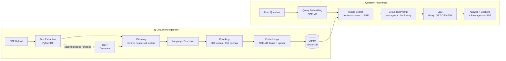

<div align="center">

# CiteRAG

### Unified Multi-Document Question Answering with Source Citations

Upload your PDFs, ask questions in plain language, and get answers grounded in your documents, with the file and page each claim came from.


[Demo](#-demo) • [Features](#-features) • [How It Works](#-how-it-works) • [Getting Started](#-getting-started) • [API](#-api-reference) • [Configuration](#-configuration)

</div>

---

## 📌 Overview

**CiteRAG** is a full-stack **Retrieval-Augmented Generation (RAG)** application for asking questions across several PDF documents at once.

The LLM doesn't answer from its general knowledge. CiteRAG first retrieves the most relevant passages from your uploaded documents, then has the model answer **only from those passages**. Every answer comes with:

- 📄 **Source citations**: which file and which pages the answer came from
- 🔍 **Retrieved passages**: the exact text chunks used, with relevance scores
- 💬 **Conversation context**: follow-up questions remember the earlier turns

---

## 🎬 Demo

<!--
  HOW TO ADD YOUR VIDEO:
  Open this file in GitHub's web editor and drag your .mp4 file onto the line below.
  GitHub uploads it and replaces it with a link that plays inline.
-->

> 🎥 _Demo video coming soon_

### Screenshots

<!-- Put your screenshots in an `assets/` folder at the repo root and keep these file names, or change the paths. -->

<p align="center">
  
</p>

| Uploading documents | Answer with citations | Retrieved passages |
|:---:|:---:|:---:|
|  |  |  |

---

## ✨ Features

### 📂 Document management
- Upload **multiple PDFs at once** by drag-and-drop or file picker; files are indexed in parallel
- View, open, and **delete** documents from the library
- **OCR support** for scanned pages and text inside images
- Optionally put PDFs in a `corpus/` folder to have them indexed automatically at startup

### 💬 Question answering
- Ask natural-language questions **across all uploaded documents**
- Answers are **grounded only in your documents**, with inline `[filename, page X]` tags
- A **citation list** per answer, grouped by file with page numbers
- An expandable view of the **retrieved passages**, with scores and page numbers
- **Multi-turn chat**: follow-up questions use the recent conversation
- Responds in the **same language** as the question
- Answers are **streamed** to the UI over Server-Sent Events (SSE)

### ⚙️ Engineering
- **Hybrid search**: semantic (dense) and keyword (sparse) retrieval merged with Reciprocal Rank Fusion
- **Idempotent ingestion**: re-uploading the same PDF never duplicates data or re-computes embeddings
- **Fault-tolerant pipeline**: a failing page or chunk is logged and skipped instead of crashing the upload
- **Pluggable LLM providers**: Groq by default, Google Gemini supported
- **500+ automated tests** (pytest + Hypothesis property-based tests) in a GitHub Actions CI pipeline
- **Dockerized** backend with an embedded vector database, so no separate DB setup
- Light and dark themes

---

## 🧠 How It Works



### 1️⃣ Document ingestion

| Step | Description |
|---|---|
| **Text extraction** | PyMuPDF reads the text layer of every page. |
| **OCR fallback** | Pages with no text get full-page OCR with Tesseract. Text inside embedded images is also extracted and labelled as image content, so the model can refer to figures and tables. |
| **Cleaning** | Normalizes whitespace, removes control characters, and drops lines that repeat on at least half the pages (running headers and footers). |
| **Language detection** | Each page is tagged with its language, and the tag is stored with each chunk. |
| **Chunking** | A recursive, token-aware splitter (tiktoken) breaks text at paragraph and sentence boundaries into ~800-token chunks with 150 tokens of overlap. Each chunk keeps its **filename, page number and position**, which later become the citations. |
| **Embedding** | **BAAI BGE-M3** produces two vectors for each chunk in one pass: a 1024-dim **dense** vector (meaning) and a **sparse** vector (keywords). |
| **Storage** | Chunks go to **Qdrant**. Each chunk ID is a **SHA-256 hash** of its content and location, so chunks that are already stored are skipped before embedding. That makes re-uploads fast and free of duplicates. |

### 2️⃣ Question answering

1. **Validation**: empty or very long questions are rejected before any computation.
2. **Hybrid retrieval**: the question is embedded with BGE-M3, and **one Qdrant query** runs a semantic search and a keyword search together, merging the results with **Reciprocal Rank Fusion (RRF)**. Semantic search finds paraphrased content; keyword search catches exact terms such as names, codes and section numbers.
3. **Grounded generation**: the top passages, each tagged `[filename, page X]`, go into the prompt with the recent conversation history. The prompt tells the model to use only these passages and to cite every claim. The model runs on **Groq**, with a timeout and clear error handling.
4. **Citations**: the structured citation list (file → pages) is built from the **retrieved chunks' metadata**, not parsed out of the model's text, so it's always accurate about which sources were used.

---

## 🛠️ Tech Stack

| Category | Technologies |
|---|---|
| **Frontend** | React 19, Vite, JavaScript, CSS, Axios, react-markdown |
| **Backend** | Python, FastAPI, Uvicorn |
| **LLM** | Groq API · OpenAI GPT-OSS-20B (Google Gemini as an alternative) |
| **Embeddings** | BAAI BGE-M3 (FlagEmbedding) |
| **Vector database** | Qdrant (embedded locally, or Qdrant Cloud) |
| **Document processing** | PyMuPDF, Tesseract OCR, tiktoken, langdetect |
| **Testing & CI** | pytest, Hypothesis, flake8, ESLint, GitHub Actions |
| **DevOps** | Docker, Docker Compose, nginx |

---

## 🚀 Getting Started

### Prerequisites

- [Docker](https://docs.docker.com/get-docker/) and Docker Compose
- [Node.js](https://nodejs.org/) 20 or newer
- A **Groq API key**: free from [console.groq.com](https://console.groq.com/keys)
- A **Google API key** from [aistudio.google.com](https://aistudio.google.com/) (the backend currently needs it at startup)

### 1. Clone the repository

```bash
git clone https://github.com/ViBH2204/citerag.git
cd citerag
```

### 2. Set up environment variables

Create a `.env` file in the project root:

```env
LLM_PROVIDER=groq
GROQ_API_KEY=your-groq-api-key
GROQ_MODEL=openai/gpt-oss-20b
GOOGLE_API_KEY=your-google-api-key
VITE_API_URL=http://localhost:7860
```

### 3. Start the backend

```bash
mkdir -p corpus        # optional: put PDFs here to index them at startup
docker compose up --build
```

> ⏳ The first start downloads the BGE-M3 embedding model (~2 GB). It's cached afterwards, so later starts are much faster.

| Service | URL |
|---|---|
| Backend API | http://localhost:7860 |
| Swagger API docs | http://localhost:7860/docs |
| Health check | http://localhost:7860/healthz |

### 4. Start the frontend

In a new terminal:

```bash
cd frontend
npm install
npm run dev
```

Open **http://localhost:5173**, upload some PDFs, and start asking questions. 🎉

<details>
<summary><b>Run the backend without Docker</b></summary>

<br>

```bash
cd backend
python -m venv .venv
source .venv/bin/activate          # Windows: .venv\Scripts\activate
pip install -r requirements.txt

# Install Tesseract for OCR:
#   Ubuntu: sudo apt install tesseract-ocr
#   macOS:  brew install tesseract

export QDRANT_PATH=./qdrant_data
export PYTHONPATH="$(cd .. && pwd):$(pwd)"
uvicorn app:app --port 7860
```

Uploaded PDFs are saved to `/data/pdfs`, so make sure that directory exists and is writable.

</details>

---

## 📡 API Reference

| Method | Endpoint | Description |
|---|---|---|
| `POST` | `/upload` | Upload and index a PDF (`multipart/form-data`, field `file`) |
| `GET` | `/documents` | List all indexed documents |
| `GET` | `/documents/{filename}` | Get the original PDF |
| `DELETE` | `/documents/{filename}` | Delete a document and all its vectors |
| `POST` | `/conversations` | Start a new conversation |
| `POST` | `/conversations/{id}/query` | Ask a question (JSON or streaming) |
| `DELETE` | `/conversations/{id}` | Clear the conversation history |
| `GET` | `/healthz` | Health check (API + Qdrant status) |
| `GET` | `/metrics` | Response latency and evaluation metrics |

### Example: ask a question

```http
POST /conversations/{id}/query
Content-Type: application/json

{
  "q": "What are the key findings of the report?",
  "top_k": 5,
  "stream": true
}
```

### Streaming response (SSE)

```text
data: {"type": "token",   "text": "The "}
data: {"type": "token",   "text": "report "}
data: {"type": "sources", "data": [{"filename": "report.pdf", "pages": [3, 5]}]}
data: {"type": "chunks",  "data": [{"text": "...", "score": 0.83, "filename": "report.pdf", "page_number": 3}]}
data: {"type": "end"}
```

With `"stream": false`, the response is plain JSON: `{ "answer", "citations", "chunks" }`.

---

## ⚙️ Configuration

| Variable | Default | Description |
|---|---|---|
| `LLM_PROVIDER` | `groq` | LLM provider: `groq` or `gemini` |
| `GROQ_API_KEY` | — | Groq API key |
| `GROQ_MODEL` | `openai/gpt-oss-20b` | Groq model |
| `GOOGLE_API_KEY` | — | Google API key (required at startup) |
| `QDRANT_URL` / `QDRANT_API_KEY` | _empty_ | Set both to use Qdrant Cloud instead of embedded mode |
| `QDRANT_COLLECTION` | `corpus` | Qdrant collection name |
| `CHUNK_MAX_TOKENS` | `800` | Maximum tokens per chunk |
| `CHUNK_OVERLAP_TOKENS` | `150` | Overlap between chunks (10–30% of chunk size) |
| `DEFAULT_TOP_K` | `5` | Number of passages retrieved per question |
| `GENERATION_TIMEOUT_S` | `30` | LLM request timeout (seconds) |
| `SKIP_INGESTION` | `false` | Skip indexing the `corpus/` folder at startup |
| `VITE_API_URL` | `http://localhost:7860` | Backend URL for the frontend |

---

## 📁 Project Structure

```text
citerag/
├── backend/
│   ├── app.py                # FastAPI application & endpoints
│   ├── embedding.py          # BGE-M3 dense + sparse embeddings
│   ├── vector_store.py       # Qdrant storage & hybrid search
│   ├── retrieval.py          # Query validation & retrieval
│   ├── generation.py         # Prompt building & citations
│   ├── conversation.py       # Chat history management
│   ├── evaluation.py         # Latency & retrieval metrics
│   ├── providers/            # LLM providers (Groq, Gemini)
│   ├── ingestion/            # Extract → clean → chunk → index pipeline
│   └── tests/                # Unit, property-based & integration tests
├── frontend/
│   └── src/
│       ├── App.jsx           # Main workspace: document library + chat
│       ├── components/       # Citations, passages, pipeline view, theme
│       └── services/api.js   # REST + streaming API client
├── docker-compose.yml
└── README.md
```

---

## 🧪 Running Tests

```bash
cd backend
pip install -r requirements.txt
python -m pytest tests/ -v
```

Tests, linting and the frontend build run automatically on every push through **GitHub Actions**.

---

## 🚧 Limitations & Future Work

**Current limitations**
- Only PDF files are supported
- No user authentication; all users share one document library
- Chat history is kept in memory and is cleared when the server restarts
- The full answer is generated before it's streamed to the UI

**Planned improvements**
- [ ] True token-by-token streaming from the LLM to the browser
- [ ] Ask questions about selected documents only
- [ ] Clickable citations that open the PDF at the cited page
- [ ] User accounts with private document libraries
- [ ] Support for DOCX and TXT files

